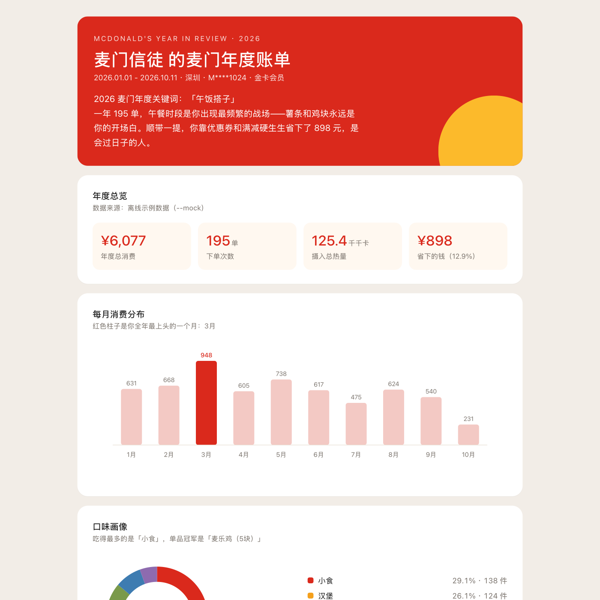

# 麦门年度账单 · mcd-year-in-review

> 基于麦当劳 MCP，生成一份可以截图发朋友圈的年度消费 / 口味 / 作息画像。



---

## 一句话介绍

身材不是主题，省钱不是主题，点餐更不是主题——**麦门年度账单**要讲的是「你的麦当劳一年」。

输入你的历史订单，它会产出一份单文件 HTML 年报：总消费、总热量、每月趋势、口味画像、作息分布、门店足迹、成就徽章、趣味换算，每个模块都适合截图分享。

为什么这很重要？因为这次大赛的**评审只看 GitHub Star**。而 Star 怎么来？要靠**传播**。年报的产出物本身就是社交货币。

## 核心能力

- 数据真实：通过麦当劳 MCP 的 `order-list`、`query-order`、`list-nutrition-foods`、`query-my-account` 拉取历史订单、餐品营养与积分账户。
- 套餐自动展开：真实订单里的「随心配」「买薯送薯」等套餐会被展开成单品，热量与口味画像才准确。
- 离线可跑：内置 2026 年全年示例数据（`--mock`），零 Token 也能一键看效果。
- 单文件年报：生成的 `year-in-review.html` **不依赖任何外部 CDN/图表库**，双击打开就是一张完整的「年度账单长图」。
- 隐私保护：会员卡号**默认打码**展示，避免截图分享时泄露账号。
- 成就徽章：声明式规则引擎，新增徽章只需加一行规则。
- 零第三方依赖：只用 Python 标准库（`urllib`、`datetime`、`html`、`json`）。

## 快速开始

> 📖 **第一次使用？** 直接看 [**USAGE.md**](USAGE.md)——按「只看效果 / 跑自己的数据 / 在 WorkBuddy 里用 / 在其它 MCP 客户端用」分了四类，各自有可直接复制的命令。

```bash
# 1. 克隆仓库
git clone https://github.com/<仓库地址>.git
cd mcd-year-in-review

# 2. 零安装直接跑（无需第三方依赖、无需 Token、无需联网）
PYTHONPATH=src python3 -m mcd_year_in_review demo

# 3. 生成可分享的 HTML 年报
PYTHONPATH=src python3 -m mcd_year_in_review --mock --html year-in-review.html
```

嫌 `PYTHONPATH=src` 麻烦的话，装一次就能用短命令：

```bash
pip install .
mcd-year-in-review demo
```

环境要求：**Python 3.9+**（已在 3.9.6 与 3.13.12 实测通过），**零第三方依赖**。

## 真实数据接入

真实历史订单来自 `order-list`，营养/热量来自 `list-nutrition-foods`，积分账户来自 `query-my-account`。**必须先有 Token**，否则只能看离线示例数据。

1. 申请麦当劳 MCP Token（参考 [M-China/mcd-mcp-server](https://github.com/M-China/mcd-mcp-server)）。

2. 配置 Token（二选一）：

```bash
# 方式 A：环境变量
export MCD_MCP_TOKEN="your_token"
export MCD_MCP_ENDPOINT="https://mcp.mcd.cn"  # 默认，可不填

# 方式 B：命令行直接传
PYTHONPATH=src python3 -m mcd_year_in_review account --token "your_token"
```

3. **先验证 Token 是否可用**（推荐第一步）：

```bash
PYTHONPATH=src python3 -m mcd_year_in_review account --token "your_token"
```

能打印出**会员卡号 / 积分**，说明 Token 有效；若报 `401` 则 Token 无效或已过期。会员卡号默认打码展示。

4. 拉取真实订单并生成年报：

```bash
# 基础模式
PYTHONPATH=src python3 -m mcd_year_in_review --live --html report.html --token "your_token"

# 逐单补充渠道/优惠（更慢但更准）
PYTHONPATH=src python3 -m mcd_year_in_review --live --detail --html report.html --token "your_token"
```

> 官方 `query-my-account` 不一定会返回昵称和等级；如果拿不到，程序会用「麦当劳会员」+ 会员卡号（打码）占位。你仍可用 `--name` 覆盖显示名称。

> 省钱合计：如果官方列表接口未给出优惠明细，该字段会显示为「—」。加 `--detail` 有机会从 `query-order` 补齐，但不保证所有订单都能拿到。

## 命令说明

```bash
python3 -m mcd_year_in_review [report|demo|export|account] [选项]
```

| 子命令 | 作用 | 常用选项 |
|---|---|---|
| `report`（默认）| 生成年度账单 | `--html <PATH>` `--json <PATH>` `--start/--end` `--name` `--city` `--token` `--detail` |
| `demo` | 用离线示例数据一键演示 | 同 `report` |
| `export` | 只导出归一化订单 JSON | `--json <PATH>` |
| `account` | **只读取并打印真实会员账号信息（验证 Token 用）** | `--token` |

数据源优先级：
- `--mock`：强制离线示例数据。
- `--live` / `--token` / 环境变量 `MCD_MCP_TOKEN`：强制走麦当劳 MCP。
- `--detail`：仅在真实数据模式下生效，逐单调用 `query-order` 补充渠道/优惠。
- 什么都不写：检测到 `MCD_MCP_TOKEN` 就走真实数据，否则自动回退到 mock。

## 项目结构

```
mcd-year-in-review/
├── src/mcd_year_in_review/
│   ├── models.py          # Order / OrderItem 数据模型
│   ├── stats.py           # 年度统计引擎
│   ├── badges.py          # 成就徽章规则引擎
│   ├── nutrition.py       # 官方营养表解析与餐品归类
│   ├── mcp_client.py      # 零依赖 MCP Streamable HTTP 客户端
│   ├── source.py          # MCP 数据源抽象与容错解析
│   ├── mock_data.py       # 2026 年全年示例订单
│   ├── report.py          # 单文件 HTML 年报生成
│   ├── render.py          # 终端文本年报
│   └── cli.py             # 命令行入口
├── tests/                 # 单元测试
├── examples/              # 演示产物
│   ├── demo_output.md     # 终端年报示例
│   ├── year-in-review.html
│   └── orders.json
├── README.md              # 项目介绍（本文件）
├── USAGE.md               # 📖 面向使用者的完整使用指南
├── CONTEST_DECLARATION.md # 官方原版参赛声明，请勿改动
├── MCP_INTEGRATION.md     # MCP 接入说明
├── mcp-config.example.json
├── workbuddy.md           # WorkBuddy 专项奖励说明
├── skill/SKILL.md         # 在 WorkBuddy 里当对话式 Skill 用
├── requirements.txt       # 空文件：零第三方依赖
└── pyproject.toml
```

## 技术亮点

- **时段归一化**：把下单时间映射到早餐 / 午餐 / 下午茶 / 晚餐 / 夜宵，并正确处理跨天（凌晨 1 点归为夜宵）。
- **年度画像算法**：从 7 个维度（月度、类目、单品、时段、门店、渠道、优惠）计算人设标签，千人千面。
- **纯 SVG 可视化**：月度柱状图、类目环形图、横向条形图全部由内联 SVG 生成，没有脚本、没有网络依赖。
- **徽章规则 DSL**：规则是数据，新增徽章不用改判断逻辑。

## 示例输出

见 [`examples/demo_output.md`](examples/demo_output.md) 或直接用浏览器打开 [`examples/year-in-review.html`](examples/year-in-review.html)。

## 许可证

MIT License — 详见 [LICENSE](LICENSE)。

> 本项目为麦当劳程序员节创意开发大赛参赛作品，非麦当劳官方产品。餐品、价格及供应状态以麦当劳官方渠道实时结果为准；年报中的热量/健康换算纯属趣味玩梗，不构成专业建议。
